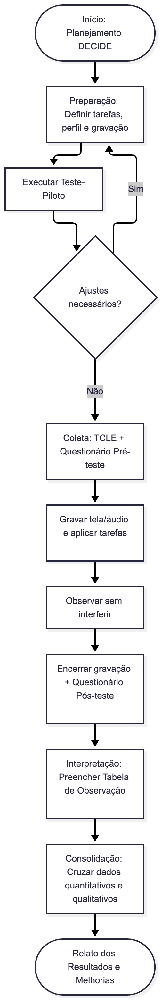

**\[1 solução completa por pessoa da equipe\]**

**Método de Avaliação de Usabilidade por Observação do Usuário**   
**(o número de usuários observados é igual o número de membros da equipe)**

1) **Fluxograma de Avaliação de Usabilidade por Observação do Usuário \[1 solução por equipe\]**

2) **DESCRIÇÃO DO PROCEDIMENTO DE PREPARAÇÃO DO TESTE \[1 solução por equipe\]**

* *Passo 1: Configuração do Ambiente e Ferramentas de Registro*
  * Preparar o link do sistema em execução (ambiente web) e testar o software de gravação de tela e microfone (ex.: OBS Studio ou Google Meet) para garantir que o cursor, os cliques e a voz do participante sejam capturados com nitidez[cite: 13].

* *Passo 2: Lista de Tarefas que o Usuário Deve Cumprir*
  1. *Tarefa 1 (Cadastro de Pet):** Acesse a área de pets e cadastre um novo animal informando nome, raça, data de nascimento e foto.
  2. *Tarefa 2 (Registro de Saúde — Vacina):** Entre no perfil do pet recém-cadastrado (ou de um pet existente como Fiu/Tina) e registre uma nova vacina aplicada.
  3. *Tarefa 3 (Controle de Peso):** Ainda no painel do pet, acesse a seção de Peso e adicione uma nova pesagem atualizada.
  4. *Tarefa 4 (Agendamento):** Vá até a área de Agendamentos e crie um novo agendamento de consulta veterinária ou banho/tosa.

* *Passo 3: Formulário de Perfil do Usuário (Pré-teste)*
  * Aplicar o questionário inicial para mapear a faixa etária, o nível de familiaridade com tecnologia e a experiência prévia do participante com cuidados de pets e aplicativos semelhantes[cite: 5, 6].

* *Passo 4: Execução do Teste-Piloto*
  * Realizar uma simulação completa com um integrante da equipe antes de testar com usuários externos, verificando se os enunciados das tarefas estão claros (sem entregar "dicas" de onde clicar) e se o tempo estimado está adequado[cite: 5].

* *Passo 5: Roteiro de Condução da Sessão*
  * Ler as instruções iniciais reforçando que o sistema está sendo testado (e não o usuário), solicitar que pense em voz alta durante a navegação e iniciar a gravação somente após o aceite do Termo de Consentimento.

3) **RESULTADOS DO TESTE [1 solução por equipe]**

**Avaliação de cada Tarefa — Usuário 01 (Código/Iniciais)**

| Tarefa | Grau de Sucesso | Total de Erros cometidos | Tipos de Erros | Tempo Necessário | Grau de Satisfação |
| :--- | :--- | :---: | :--- | :---: | :--- |
| **1. Cadastrar novo pet** | *(Ex.: Sucesso Total)* | *(Ex.: 0)* | *(Nenhum)* | *(Ex.: 38 segundos)* | *(Ex.: Satisfeito / Sem confusão)* |
| **2. Registrar nova vacina** | *(Ex.: Sucesso Parcial)* | *(Ex.: 1)* | *(1) Compreensão* | *(Ex.: 52 segundos)* | *(Ex.: Confusão Leve)* |
| **3. Adicionar pesagem** | | | | | |
| **4. Criar agendamento** | | | | | |

**Links dos vídeos:**

**Respostas do Formulário do Usuário:**

**Conclusão da avaliação por observação do usuário:**
